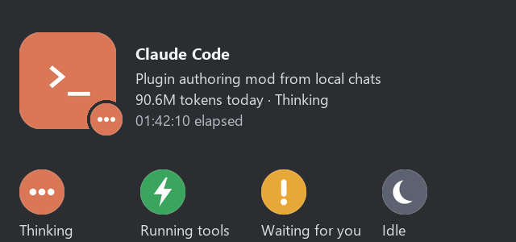

# Claude Discord Presence

Claude Discord Presence is a plugin for Claude Code. It shows your Claude Code work as an activity on your Discord profile.

The plugin is the only part. It does not install a separate program, a background service or a startup entry. A small helper script runs while Claude Code is open and stops when Claude Code closes.



## What Discord shows

The plugin shows one activity for the full Claude Code app, also when many chats are open.

| Part of the card | Content |
|---|---|
| Name | Claude Code |
| Line 1 | The title of the chat that you used last |
| Line 2 | The tokens that all chats used today, and the current state |
| Timer | The time since the chat started |
| Badge | An icon for the current state |

### States

| State | When |
|---|---|
| Thinking | Claude works on a reply. |
| Running tools | Claude runs a tool. |
| Waiting for you | Claude asks for a permission or asks you a question. |
| Idle | The reply is complete. |

## How the plugin works

### The helper

Each Claude Code session starts a copy of `scripts/presence.py`. A file lock lets one copy connect to Discord. The other copies wait. If the connected copy stops, a waiting copy connects in its place.

The helper connects to the Discord desktop app through its local IPC pipe. It sends a new activity only when the content changes. It sends no more than one update every 4 seconds, because Discord accepts 5 updates in 20 seconds.

The card clears when the last Claude Code session closes.

### Session files

Each session writes a small JSON file to `<config dir>/discord-presence/`. The config dir is `CLAUDE_CONFIG_DIR`, or `~/.claude` when that variable is not set. The file holds the session ID, the state, the start time and the time of the last activity. The session writes the file again every 60 seconds. The helper ignores a file that is older than 150 seconds.

### Chat title

The helper reads the chat title from the transcript of the chat. A title that you set has priority over the title that Claude Code makes.

### Tokens today

The helper reads the transcripts under `<config dir>/projects/`. It adds the input, output, cache-write and cache-read tokens of each response since local midnight. It counts each response one time. After the first count, it reads only the new lines of each transcript.

### Data

- The plugin makes no model calls.
- The plugin sends data only to the Discord desktop app on your computer.
- Discord gets the chat title, the token total, the state and the start time.
- Discord loads the images from this repository.

## Settings

| Setting | Default | Effect |
|---|---|---|
| `clientId` | empty | A Discord Application ID. Use it to show your own app name. |
| `imageBase` | empty | An https folder URL with your own five images. |

When a setting is empty, the plugin uses the built-in value.

## Requirements

- Claude Code 2.1.286 or newer. The plugin API is early access. A later release can change it.
- Python 3 on the `PATH`.
- The Discord desktop app. The Discord web app does not accept Rich Presence.

## Install

1. Add the marketplace in Claude Code:

   ```
   /plugin marketplace add MridulNegi2005/claude-discord-presence
   ```

2. Install the plugin:

   ```
   /plugin install discord-presence@claude-discord-presence
   ```

To load the plugin from a local folder, start Claude Code with this flag:

```
claude --plugin-dir path/to/claude-discord-presence
```

## License

MIT. See [LICENSE](LICENSE).
